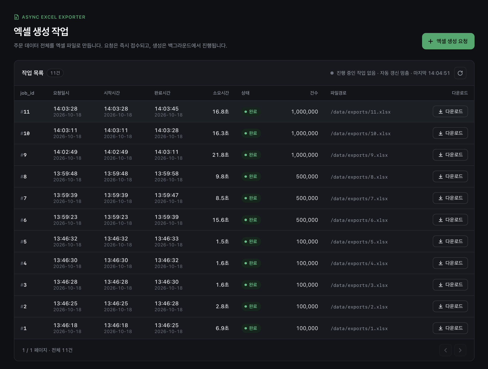
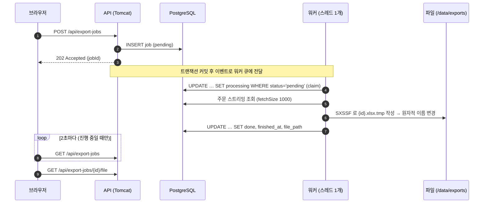
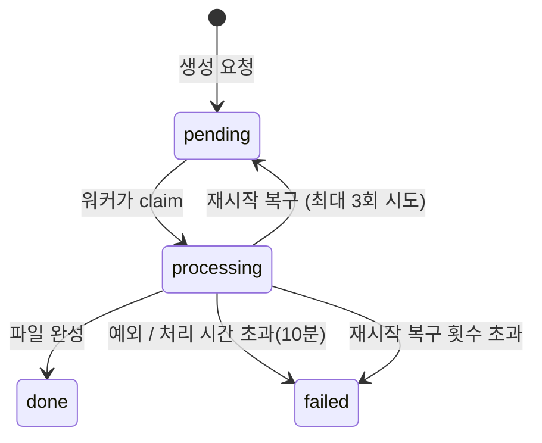

# Async Excel Exporter

주문 데이터 전체를 엑셀 파일로 만드는 **비동기 엑셀 생성 시스템**입니다.
생성 요청에는 즉시 응답(202)하고, 실제 파일 생성은 백그라운드 워커가 처리합니다.
진행 상태(pending → processing → done / failed)와 시작·완료 시각, 파일 경로는 DB 에 기록되고, 목록 화면에서 폴링으로 확인합니다.



- 10만 건 기준 생성 시간 약 2초(워밍업 후), 100만 건도 약 16초
- 0.5 CPU / 1GiB 컨테이너에서 **JVM 실사용 메모리가 데이터 건수와 무관하게 약 310MiB 로 일정** (10만 → 100만 건, 스트리밍 조회 + SXSSF)
- 재시작·중단·장시간 정체에도 작업이 유실되거나 영원히 processing 으로 남지 않음

---

## 1. 실행 방법

**필요한 것: Docker (Docker Compose v2)** — JDK, Gradle, PostgreSQL 설치는 필요 없습니다.

```bash
docker compose up --build -d
```

앱이 뜰 때까지 기다린 뒤(첫 빌드는 1~2분) 브라우저에서 엽니다.

```bash
curl -s localhost:8080/actuator/health
```

`{"status":"UP"}` 이 나오면 **http://localhost:8080** 에 접속해 "엑셀 생성 요청" 버튼을 누르면 됩니다.

| 구성 | 내용 |
|---|---|
| `db` | PostgreSQL 17. 첫 기동 시 `db/init` 의 스키마와 **주문 10만 건 시드**를 자동 적재 (고정 난수 시드라 매번 같은 데이터) |
| `app` | Spring Boot. 과제 지정 리소스 **0.5 CPU / 1G** (변경하지 않음). 8080 포트 |

종료와 초기화:

```bash
docker compose down -v
```

`-v` 는 DB 와 생성된 엑셀 파일 볼륨까지 지웁니다. 다음 실행은 처음 상태(시드 10만 건, 작업 0건)에서 시작합니다.

> DB 포트(5432)는 호스트에 노출하지 않습니다. 평가 환경에 이미 PostgreSQL 이 떠 있어도 포트 충돌로 기동이 실패하지 않게 하기 위함입니다.
> DB 를 직접 보려면 `docker compose exec db psql -U exporter -d exporter`.

---

## 2. API

| 메서드 | 경로 | 설명 | 응답 |
|---|---|---|---|
| `POST` | `/api/export-jobs` | 엑셀 생성 요청 | **202** + `Location` 헤더, 작업 정보 (status=`pending`) |
| `GET` | `/api/export-jobs?page=0&size=20` | 작업 목록 (최신 요청순, size 최대 100) | 200 |
| `GET` | `/api/export-jobs/{jobId}` | 작업 단건 조회 | 200 / 404 |
| `GET` | `/api/export-jobs/{jobId}/file` | 결과 파일 다운로드 | 200 / **409** (아직 done 아님) / 404 |

```bash
curl -i -X POST localhost:8080/api/export-jobs
curl -s localhost:8080/api/export-jobs/1
curl -OJ localhost:8080/api/export-jobs/1/file
```

작업 응답 예시:

```json
{
  "jobId": 1,
  "status": "done",
  "createdAt": "2026-10-18T13:46:18.512",
  "startedAt": "2026-10-18T13:46:18.540",
  "finishedAt": "2026-10-18T13:46:25.431",
  "filePath": "/data/exports/1.xlsx",
  "rowCount": 100000,
  "errorMessage": null,
  "downloadUrl": "/api/export-jobs/1/file"
}
```

- 시간은 KST(Asia/Seoul) 기준입니다.
- 오류는 RFC 9457 `ProblemDetail` 형식(`application/problem+json`)으로 응답합니다.
- 다운로드 파일명은 `주문내역_{jobId}_{완료시각}.xlsx` 이며, Range 요청(이어받기)을 지원합니다.

---

## 3. 기술 스택과 선택 이유

| 영역 | 선택 | 이유 |
|---|---|---|
| 언어·프레임워크 | Java 25, Spring Boot 4.1 | 트랜잭션·이벤트·스케줄링·graceful shutdown 을 표준 기능으로 조합할 수 있음. 스트리밍 조회(JDBC fetch size)와 POI 생태계가 성숙 |
| DB | PostgreSQL 17 | 조건부 UPDATE 로 상태 전이를 원자적으로 처리, 서버 측 커서 기반 스트리밍 조회, `now()` 로 시각 출처 단일화 |
| 엑셀 | Apache POI **SXSSF** | 최근 100행만 메모리에 두고 나머지는 디스크로 내보내는 스트리밍 방식. 건수와 무관하게 메모리가 일정 |
| 작업 저장 | JPA | 작업(job) 생성·조회 CRUD 는 JPA, 상태 전이는 네이티브 조건부 UPDATE |
| 대용량 조회 | JdbcTemplate | 10만 건을 엔티티로 만들지 않고 행 단위 콜백으로 바로 셀에 씀 (영속성 컨텍스트에 쌓이지 않음) |
| 프론트 | HTML + CSS + 순수 JS | Spring 이 정적 리소스로 함께 서빙 → 컨테이너 하나, 빌드 도구 없음 |
| 상태 확인 | 폴링 | 요구사항 범위에서 가장 단순하고 견고. 진행 중 작업이 없으면 멈춤 |

검토했지만 쓰지 않은 대안:

| 대안 | 쓰지 않은 이유 |
|---|---|
| Kafka / RabbitMQ | 단일 컨테이너·고정 리소스 조건에서 브로커 운영 비용이 이점보다 큼. **DB 를 작업 큐의 원본**으로 쓰고, 메모리 큐는 전달 수단으로만 사용 |
| `@Async` (기본 executor) | 큐 크기·거절 정책·종료 대기를 명시적으로 통제하기 어려움 → 전용 `ThreadPoolTaskExecutor` 사용 |
| XSSF (POI 기본) | 워크북 전체를 메모리 객체로 들고 있다가 마지막에 씀. 사용량이 건수에 비례해 늘어 1G 제한에서 50만~100만 건으로 키우면 위험 |
| SSE / WebSocket | 연결 유지 비용과 재연결 처리가 필요. 이 규모에서는 2초 폴링으로 충분 |

---

## 4. 구조





---

## 5. 설계 고려사항

### 5.1 즉시 응답과 작업 전달

- 요청 스레드는 job 을 `pending` 으로 저장하고 바로 202 를 돌려줍니다. 파일 생성은 기다리지 않습니다.
- 워커로의 전달은 **트랜잭션 커밋 후**(`@TransactionalEventListener(AFTER_COMMIT)`)에 합니다. 워커가 아직 커밋되지 않은 job 을 찾지 못하는 경쟁이 생기지 않습니다.
- 메모리 큐(크기 10)가 차면 job 은 그대로 `pending` 으로 남고, 10초 주기의 재제출 스케줄러가 다시 넣습니다. **DB 가 원본**이므로 큐가 넘쳐도 작업이 사라지지 않습니다.

### 5.2 중복 처리 방지

- 상태 전이는 `UPDATE … WHERE id = ? AND status = 'pending'` 같은 **조건부 UPDATE** 한 문장으로 합니다. 갱신된 행이 1개일 때만 처리를 진행합니다.
- 같은 job 이 재제출 스케줄러와 이벤트로 두 번 큐에 들어가도, claim 에 성공한 한쪽만 실행됩니다. ("중복 제출은 허용, 중복 처리는 claim 이 차단")
- 디스패처는 현재 큐에 있거나 실행 중인 job id 를 기억해 같은 job 을 불필요하게 다시 넣지 않습니다.

### 5.3 메모리 상한 (0.5 CPU / 1G)

| 지점 | 처리 |
|---|---|
| DB → 앱 | `TYPE_FORWARD_ONLY` + `fetchSize 1000` 서버 커서. 결과 전체를 메모리에 올리지 않음 |
| 앱 내부 | 행 콜백으로 바로 셀에 기록. 엔티티·리스트로 모으지 않음 |
| 앱 → 파일 | SXSSF 행 창 100. 공유 문자열 표 미사용(문자열 종류가 늘어도 메모리 일정), 임시 파일 압축 미사용(0.5 CPU 에서 CPU 절약) |
| JVM | `-XX:MaxRAMPercentage=65`. 나머지 35% 는 메타스페이스·스레드 스택·코드 캐시 몫 |
| 동시성 | 워커 1개. CPU 0.5 에서 2개를 돌리면 서로 느려질 뿐 처리량은 늘지 않음 |

엑셀 한 시트의 최대 행(1,048,576)을 넘으면 다음 시트로 이어 씁니다. 금액은 숫자 셀(`#,##0`), 주문일시는 날짜 셀로 써서 엑셀에서 바로 정렬·합계가 됩니다.

### 5.4 일관성

- **스냅샷:** 조회는 `REPEATABLE READ` 읽기 전용 트랜잭션 안에서 합니다. 생성 도중 주문이 바뀌어도 한 시점의 데이터로 파일이 만들어집니다.
- **원자적 완료:** `{id}.xlsx.tmp` 에 다 쓴 뒤 같은 디렉터리 안에서 이름을 바꿉니다(`ATOMIC_MOVE`). `done` 인데 파일이 없거나, 쓰다 만 파일이 보이는 상태가 없습니다.
- **완료 기록 실패 시:** 파일은 만들었지만 DB 에 done 기록이 실패하면 파일을 지웁니다(고아 파일 방지).
- **시각:** 요청·시작·완료 시각은 모두 DB `now()` 로 기록하고, DB 세션 시간대를 KST 로 고정했습니다. 앱 시계와 DB 시계가 섞여 시간이 역전되는 일이 없습니다.

### 5.5 장애와 종료

| 상황 | 처리 |
|---|---|
| 처리 중 컨테이너 재시작 | 기동 시 `processing` 작업을 `pending` 으로 되돌려 다시 실행 (최대 3회 시도, 초과 시 `failed`). 남은 임시 파일 정리 |
| 매번 죽는 작업 (OOM 등) | 위 시도 횟수 제한으로 무한 재시작 반복을 막음 |
| 워커 정체 | 10분 넘게 `processing` 인 작업을 `failed` 로 정리 (watchdog) |
| DB 응답 없음 | 생성 조회에 `statement_timeout` 5분 |
| 정상 종료 (`docker compose down`) | 새 요청을 멈추고 실행 중인 작업이 끝나길 최대 25초 기다림. 큐에서 대기하던 작업은 `pending` 으로 남아 다음 기동 때 처리 |

`stop_grace_period: 60s` 는 Tomcat 종료(30초) + 워커 종료 대기(25초)가 SIGKILL 전에 끝나도록 잡은 값입니다.

### 5.6 다운로드 보안

DB 의 `file_path` 를 그대로 믿지 않고, 정규화한 실제 경로가 **export 디렉터리 바로 아래의 `.xlsx`** 일 때만 내려줍니다.
쓰는 중인 `*.xlsx.tmp`, POI 임시 디렉터리, 디렉터리 밖 경로, 심볼릭 링크는 404 로 막고 원인은 서버 로그에만 남깁니다.

### 5.7 화면

- 생성 요청 중에는 버튼을 잠가 중복 클릭을 막습니다.
- 진행 중 작업이 있으면 2초마다 갱신하고, 없으면 자동 갱신을 멈춥니다. 탭이 숨겨지면 멈추고 다시 보이면 즉시 갱신합니다.
- 응답을 받은 뒤 다음 요청을 예약하므로 요청이 겹치지 않습니다. 실패 시 간격을 최대 30초까지 늘립니다.
- 서버 값은 모두 `textContent` 로 렌더링합니다(XSS 방지).

---

## 6. 측정 결과

`scripts/benchmark.sh` 로 측정했습니다.

- 작업을 한 건씩 차례로 요청하고, 소요시간은 DB 의 `finished_at - started_at` 입니다.
- 메모리는 생성 중 컨테이너 안에서 0.2초 간격으로 `memory.stat` 을 읽어 **anon**(JVM 이 실제로 쓰는 메모리)과 **페이지 캐시**(파일 쓰기로 생긴 캐시)를 나눠 최댓값을 기록합니다.
- 데이터 규모를 바꿀 때마다 앱 컨테이너를 재시작해, 각 규모의 첫 회는 JVM 이 막 뜬 상태(JIT 워밍업 전)입니다.
- 환경: MacBook Air (Apple Silicon), Docker Desktop, 앱 컨테이너 0.5 CPU / 1GiB

### 처리 시간

| 주문 건수 | 첫 회 (워밍업 전) | 이후 회차 | 처리량 (이후 평균) | 파일 크기 |
|---:|---:|---|---:|---:|
| 100,000 | 8.6s | 3.0, 1.7, 1.7, 1.9s (평균 2.1s) | 약 4.9만 행/s | 4.3MiB |
| 500,000 | 14.9s | 9.3, 7.8s (평균 8.5s) | 약 5.9만 행/s | 21.7MiB |
| 1,000,000 | 22.4s | 16.3, 15.5s (평균 15.9s) | 약 6.3만 행/s | 43.4MiB |

처리 시간이 건수에 비례합니다. 행당 비용이 일정하다는 뜻으로, 데이터가 커져도 느려지는 구간 없이 스트리밍됩니다.
첫 회가 느린 것은 JIT 컴파일 전이기 때문이며, 같은 JVM 에서 두세 번째부터 안정됩니다.

### 메모리

| 주문 건수 | **anon 최댓값 (JVM 실사용)** | JVM 힙 committed | 페이지 캐시 최댓값 | cgroup memory.peak (합계) |
|---:|---:|---:|---:|---:|
| 100,000 | **311MiB** (30%) | 55MiB | 58MiB | 375MiB (37%) |
| 500,000 | **310MiB** (30%) | 54MiB | 260MiB | 579MiB (57%) |
| 1,000,000 | **316MiB** (31%) | 55MiB | 520MiB | 856MiB (84%) |

- **JVM 실사용 메모리(anon)는 10만 → 100만 건에서도 약 310MiB 로 일정**합니다. 힙도 55MiB 안팎에서 움직이지 않습니다. 스트리밍 조회와 SXSSF 행 창(100행) 덕분에 메모리에 쌓이는 데이터가 없기 때문입니다.
- 건수에 따라 커지는 것은 **페이지 캐시**입니다. SXSSF 가 디스크에 내보내는 임시 시트 파일과 결과 xlsx 를 쓰면서 생긴 캐시로, 회차가 이어지면 앞서 만든 결과 파일 몫까지 누적됩니다.
- 페이지 캐시도 cgroup 메모리 사용량에 포함됩니다(`memory.peak` 은 anon + 페이지 캐시 + 커널 메모리의 최댓값). 다만 캐시는 회수 가능한 메모리라, 사용량이 한도에 가까워지면 커널이 OOM 보다 먼저 캐시를 회수합니다. OOM 위험은 **회수할 수 없는 메모리(anon 등)가 한도에 가까울 때** 생기며, 이 측정에서 anon 은 한도의 약 31% 입니다.
- 따라서 100만 건의 `memory.peak` 84% 는 "한도의 84% 를 반드시 써야 한다"가 아니라 "남는 메모리를 캐시로 채웠다"에 가깝습니다. 더 엄격하게 확인하려면 `memory.events` 의 `oom`/`oom_kill`, `memory.stat` 의 회수 지표(`pgscan`, `pgsteal`)를 함께 보면 됩니다.
- anon 310MiB 중 힙은 약 55MiB 이고, 나머지는 클래스 메타데이터·JIT 코드 캐시·스레드 스택 등 힙 밖 메모리입니다.
- 0.5 CPU 컨테이너에서 JVM 은 자동으로 Serial GC 를 선택합니다. 작업이 끝나면 힙을 다시 줄여 대기 상태 메모리도 낮게 유지됩니다.

### 측정하지 않은 항목

이슈(#14)에서 함께 계획했지만 이번 측정 범위에서 제외한 항목입니다.

| 항목 | 상태 |
|---|---|
| XSSF 대비 SXSSF 메모리 비교 | 미측정. XSSF 경로가 코드에 없어 별도 실험 코드가 필요. 근거는 3장 "검토한 대안"의 설명으로 대신함 |
| 생성 중 조회 API 응답 시간 | 미측정. 부하 테스트(k6)와 함께 별도 이슈로 진행 예정 |
| 워커 1개 vs 2개 처리량 | 미측정. 0.5 CPU 에서 워커 1개를 택한 이유는 5.3 의 설명으로 대신함 |
| 앱 기동 시간 | 미측정 (Spring Boot 기동 로그 `Started … in N seconds` 로 확인 가능) |
| 강제 종료 후 복구 | 기능만 확인. 생성 중 앱 컨테이너를 강제 종료 후 재기동하면 중단된 작업이 `pending` 으로 복구되어 다시 처리됨을 확인했고, 통합 테스트로도 검증함. 복구까지 걸리는 시간은 측정하지 않음 |

CI(GitHub Actions)에서도 매 PR 마다 10만 건 end-to-end 후 컨테이너 memory.peak 를 기록하며(290MiB / 1024MiB), 한도의 80% 를 넘으면 실패합니다.

재현:

```bash
docker compose down -v && docker compose up --build -d
scripts/benchmark.sh
docker compose restart app && ROWS=500000 RUNS=3 scripts/benchmark.sh
docker compose restart app && ROWS=1000000 RUNS=3 scripts/benchmark.sh
docker compose down -v
```

---

## 7. 테스트

```bash
./gradlew test
```

- Testcontainers 로 **실제 PostgreSQL 17** 을 띄우고, 운영과 같은 `db/init` SQL 로 스키마를 만듭니다. (Docker 필요)
- 테스트 메서드 45개 (파라미터화 포함 실행 케이스 51개)

| 영역 | 검증 내용 |
|---|---|
| API | 202 + Location, 목록 정렬·페이징·size 상한, 404 ProblemDetail |
| 워커 | pending → processing → done 전이, 실패 시 failed + 사유, 두 스레드 동시 claim 시 정확히 하나만 성공, 큐가 가득 차도 결국 처리됨, 종료 중 대기 작업은 pending 유지 |
| 엑셀 | 행 수·첫/마지막 주문 id, 숫자·날짜 셀 타입, 시트 넘김 (SAX 로 읽어 메모리 부담 없이 검증) |
| 복구 | 재시작 복구·시도 횟수 초과, watchdog, pending 재제출, 중복 제출 방지, 임시 파일 정리 |
| 다운로드 | 정상·Range(206)·409·404, 경로 탈출·임시 파일·심볼릭 링크 차단 |
| 시간 | DB 세션 시간대가 KST 로 고정되는지 |

CI(`.github/workflows/ci.yml`)는 빌드·테스트 후 `docker compose up --build` 로 실제 구성을 띄워
health → 시드 10만 건 → 엑셀 생성 end-to-end → 컨테이너 메모리 피크를 확인합니다.

---

## 8. 한계와 개선 방향

| 한계 | 개선 방향 |
|---|---|
| 단일 컨테이너 전제 (실행 큐가 프로세스 메모리) | 과제 조건(단일 백엔드 컨테이너)에 맞춘 의도적 선택. 작업의 원본은 DB 라 재시작해도 유실되지 않고, 조건부 UPDATE(claim)로 중복 처리도 막혀 있음 |
| watchdog 은 상태만 failed 로 바꾸고 실행 중인 스레드를 멈추지 못함 | 생성 루프에 취소 플래그 확인 추가 |
| 생성된 파일의 보관 기한 없음 | 보관 기간이 지난 파일 삭제 스케줄러 + `expired` 상태 |
| 상태 확인이 폴링 | 사용자 수가 많아지면 SSE 로 전환 |
| 작업 간 우선순위·사용자 구분 없음 | 요청자 정보와 사용자별 동시 실행 제한 |

---

## 9. 프로젝트 구조

```
src/main/java/com/excel
├── common/error            # 예외 → ProblemDetail 변환
└── exportjob
    ├── api                 # REST 컨트롤러, 응답 DTO
    ├── application         # 작업 생성·조회, 상태 전이, 다운로드 검증
    ├── domain              # ExportJob 엔티티, 상태, 조건부 UPDATE 리포지토리
    ├── worker              # 디스패처(전용 executor), 작업 처리기
    ├── export              # 주문 스트리밍 조회, SXSSF 시트 작성, 파일 생성
    ├── maintenance         # 재시작 복구, watchdog, pending 재제출 스케줄러
    └── config              # app.export.* 설정, executor
src/main/resources/static   # 목록 화면 (HTML/CSS/JS)
db/init                     # 스키마, 10만 건 시드
scripts/benchmark.sh        # 측정 스크립트
```
